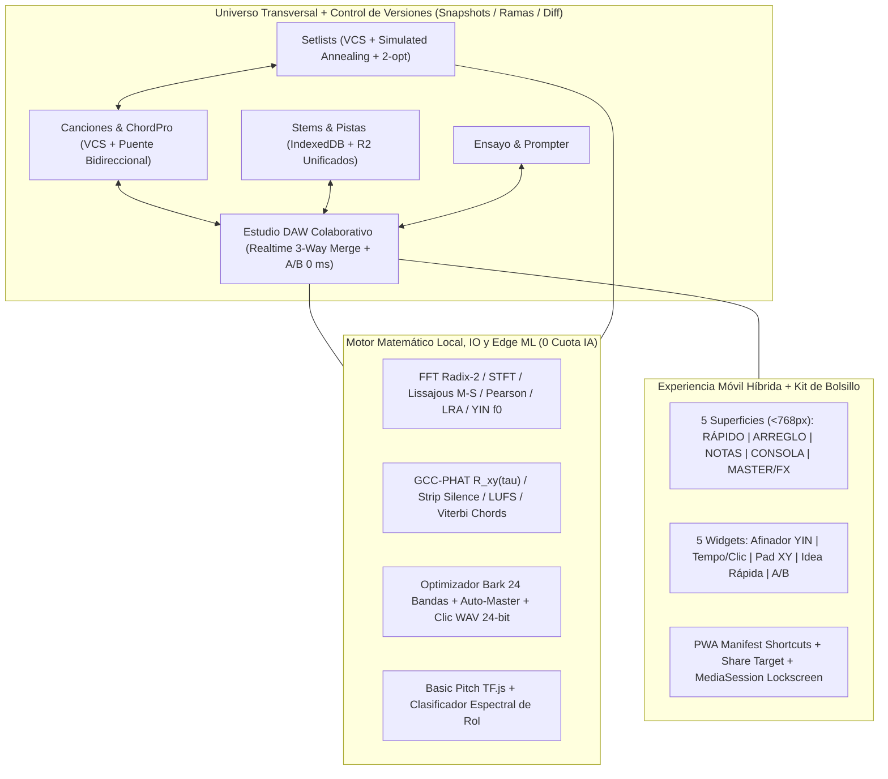

# Plan Maestro: Estudio DAW Profesional Colaborativo, Control de Versiones Musical, DSP Matemático, Modelos IO/ML y Ecosistema Móvil

**Estado:** Hub en producción (PR #61, correcciones de la revisión en PR #63); Worker `1.5.1` desplegado el 2026-11-27 (ver sección 5)  
**Ámbito:** `bandait-leader-web`, `bandait-stems-worker`, `bandait-protocol`, `landing/hub`  
**Fuente de Verdad Raíz:** [`docs/PLAN_BANDAIT_3.0_MASTER.md`](PLAN_BANDAIT_3.0_MASTER.md) y [`AGENTS.md`](../AGENTS.md)

---

## 1. Objetivo de Ingeniería

Evolucionar **Bandait Web 3.0** hacia un entorno de producción musical colaborativa, ensayo y preparación de directo con rigor matemático y cero dependencia obligatoria de cuotas de IA externa:

1. **Estudio DAW Colaborativo en Tiempo Real:** todos los roles activos de una agrupación (`Owner`, `MusicDirector`, `Musician`, `SoundEngineer`) crean, comparten, suben pistas y versionan sesiones del Estudio en Cloudflare R2 y Supabase Realtime (`Broadcast` + `Presence`), resolviendo ediciones simultáneas mediante fusión determinista de 3 vías (`mergeCollaborativeSession`). Los roles `Substitute` permanecen en solo lectura; el borrado definitivo en R2, la limpieza de huérfanos y los trabajos de IA con costo quedan restringidos a `Owner` y `MusicDirector`.
2. **Control de Versiones Musical tipo Git (DAW + Ecosistema):** snapshots inmutables, ramas/variantes (`main`, `vivo`, `acustico` o personalizadas), cálculo de diferencias estructurales legibles para músicos (`diffStudioSessions`, `diffSongs`, `diffPlaylists`) y **conmutador auditivo A/B en `0 ms`** sobre el mismo motor Web Audio sin duplicar archivos WAV en R2 ni en IndexedDB.
3. **Universo Transversal de la Canción:** contexto compartido `activeSongId` con barra persistente `SongUniverseBar` para saltar en 1 toque entre `Librería`, `Stems`, `Ensayo y Prompter`, `Estudio DAW` y `Setlists`; puente bidireccional `Song <-> StudioSession` con vista previa de diferencias antes de actualizar la ficha oficial; publicación unificada de stems en `IndexedDB + R2`; y promoción directa de maqueta libre a `Song` oficial y `Setlist`.
4. **Humanización MIDI Analógica (Tiempo + Dinámica) y Deriva por Voz:** `humanize()` con *swing* continuo, acento métrico por compás, *micro-strum* direccional en acordes, deriva temporal correlacionada AR(1) de fraseo humano y 4 presets (`pocket`, `keys`, `strum`, `analog`), complementado con `analogDrift` determinista por voz en `SynthEngine` y `DrumsEngine`.
5. **Herramientas DAW Profesionales y DSP Matemático 100 % Local (0 Cuota IA):** FFT/IFFT Cooley-Tukey radix-2, cascada espectral (una FFT por cuadro de pantalla; no es un STFT con salto fijo), 24 bandas críticas de Bark, detector fundamental $f_0$ YIN (`< 0.5 cents` **solo con señal limpia y armónica**; con ruido el error crece: medido 2026-11-27 con buffer de 4096 a 48 kHz, hasta ~9 cents con SNR 20 dB y 50-65 cents en graves con SNR 10 dB, y la confianza baja a ~0,4-0,5, por debajo del umbral `YIN_RELIABLE_CONFIDENCE` 0,7), alineación inter-pista de fase y retardo por correlación cruzada generalizada GCC-PHAT ($R_{xy}(\tau)$) + polaridad absoluta respecto de la referencia, detección local de BPM (flujo espectral en dos bandas con corrección de octava) / Tonalidad (Krumhansl-Schmuckler) / Acordes (HMM Viterbi) con confianza real y umbral antes de escribir en la sesión, transformaciones de onda (`LUFS`/`dBTP`, *Strip Silence* con histéresis de Schmitt, reversa, curvas de fundido `linear`/`exp` ($x^{2,2}$)/`scurve` (coseno elevado)), procesadores `saturator` (4x oversampling, nivel compensado, latencia medida), `stereo_imager` (Mid/Side + graves en mono por cruce Linkwitz-Riley) y `de_esser` (bandas complementarias), `Auto-Master` calibrado midiendo el render (±0,5 LU y pico real bajo el techo, varios renders offline: no es instantáneo), generador sintetizado WAV 24-bit de Clic/Guía y generador armónico MIDI.

   **Tiempos reales (no "< 50 ms"):** la detección musical de 45 s tarda del orden de 150-250 ms (medido en node, un núcleo) y corre en un Web Worker; Auto-Master hace 1 render sin master + hasta 3 con la cadena y mide por trozos sin congelar la interfaz; el afinador hace ~1 ms por lectura de 4096 muestras.
6. **Investigación de Operaciones (IO), Metaheurísticas y Edge ML (Estudio DAW y Setlists):**
   - `setlistOptimizer.ts`: **Simulated Annealing + búsqueda local 2-opt** minimizando choques armónicos Camelot, saltos bruscos de BPM, desviación respecto al arco dramático de energía y fatiga vocal consecutiva, respetando canciones ancladas en posiciones fijas (`pinnedIndices`).
   - `mixOptimizer.ts`: **Desenmascaramiento Espectral sobre 24 Bandas Bark** mediante descenso coordenado acotado (paneo complementario, filtro paso-alto y recortes quirúrgicos de EQ).
   - `trackClassifier.ts`: clasificador espectral local de rol (`kick`, `bass`, `vocals`, `drums`, `guitar`, `keys`) + cuantización armónica post-transcripción para la red neuronal en navegador `@spotify/basic-pitch` (`TF.js`) + telemetría matemática compacta hacia el asistente conversacional.
7. **Divulgación Progresiva (`1-Clic` + `Modo LAB`) y Experiencia Móvil Híbrida + 5 Widgets + PWA OS:**
   - Interfaz limpia orientada al músico con acciones de un clic y barra contextual `StudioClipActionBar`, reservando matrices y gráficas científicas (FFT, cascada espectral, Lissajous M/S, correlación de Pearson, matriz Bark, curvas de *Simulated Annealing*) detrás del interruptor `LAB`.
   - Acceso directo a `Estudio` en la barra móvil inferior, conmutador táctil de 5 superficies en `< 768 px` (`RÁPIDO` por defecto con controles `>= 44 px`, `ARREGLO` con cabeceras compactas de `84 px` y *pinch-to-zoom*, `NOTAS`, `CONSOLA` y `MASTER/FX`), grabación móvil de 1 pista en memoria hasta `180 s` (WAV 24-bit), bandeja `MobileWidgetTray` con 5 widgets de bolsillo y soporte PWA (`manifest.webmanifest` con *Shortcuts* + *Share Target* y `navigator.mediaSession` en pantalla de bloqueo).

---

## 2. Arquitectura del Sistema

---

## 3. Especificación por Capas e Inventario de Módulos

### Capa 1 — Contrato `STUDIO_V2` y Cloudflare Worker (`bandait-stems-worker`)
- [`bandait-protocol/STUDIO_V2.md`](../bandait-protocol/STUDIO_V2.md) y [`bandait-protocol/fixtures/studio_chat_tools_v2.json`](../bandait-protocol/fixtures/studio_chat_tools_v2.json):
  - Matriz de roles colaborativos (`STUDIO_COLLABORATORS`), especificación de endpoints `/vcs` y `/commits/{commit}`, protección `protected_assets` contra recolección de basura en R2, nuevos efectos nativos (`saturator`, `stereo_imager`, `de_esser`), campos opcionales retrocompatibles (`phase_invert`, `fade_shape`, `analog_drift`) y catálogo ampliado a **23 herramientas** del asistente.
- [`bandait-stems-worker/src/studioVcs.ts`](../bandait-stems-worker/src/studioVcs.ts), [`studio.ts`](../bandait-stems-worker/src/studio.ts), [`studioSession.ts`](../bandait-stems-worker/src/studioSession.ts), [`studioCleanup.ts`](../bandait-stems-worker/src/studioCleanup.ts) e [`index.ts`](../bandait-stems-worker/src/index.ts):
  - Almacenamiento inmutable de snapshots `commits/<id>.json` e índice atómico `vcs.json` con unión `protected_assets` leída en una sola operación R2 durante `studioCleanup`.

### Capa 2 — Colaboración Realtime, Control de Versiones y Puente Transversal
- [`bandait-leader-web/src/services/studio/studioCollab.ts`](../bandait-leader-web/src/services/studio/studioCollab.ts): canal desacoplado sobre Supabase Realtime (`Broadcast` + `Presence`) y fusión determinista de 3 vías `mergeCollaborativeSession(base, local, remote)`.
- [`bandait-leader-web/src/services/studio/studioVcs.ts`](../bandait-leader-web/src/services/studio/studioVcs.ts) y [`src/services/versionControl.ts`](../bandait-leader-web/src/services/versionControl.ts): ramas, snapshots y diffs estructurados tanto en Estudio DAW como en Canciones y Setlists (`WorkspaceStore.vcsMap`).
- [`bandait-leader-web/src/services/studio/songStudioBridge.ts`](../bandait-leader-web/src/services/studio/songStudioBridge.ts) y [`src/components/SongUniverseBar.tsx`](../bandait-leader-web/src/components/SongUniverseBar.tsx): sincronización bidireccional `Song <-> StudioSession`, promoción de maquetas libres y salto contextual en 1 clic.

### Capa 3 — DSP Matemático Local, Síntesis Analógica, Optimizadores IO y Edge ML
- [`bandait-leader-web/src/services/studio/dspMath.ts`](../bandait-leader-web/src/services/studio/dspMath.ts): FFT/IFFT radix-2, STFT, 24 bandas Bark, detector fundamental YIN, alineación de fase GCC-PHAT, BPM por autocorrelación de inicios, tonalidad Krumhansl-Schmuckler, acordes HMM Viterbi, correlación estéreo de Pearson, Lissajous y rango dinámico LRA.
- [`bandait-leader-web/src/services/studio/waveOps.ts`](../bandait-leader-web/src/services/studio/waveOps.ts): curvas matemáticas de fundido (`linear`, `exp`, `scurve`), normalización LUFS / True Peak, *Strip Silence* con histéresis de Schmitt y reversa de onda.
- [`bandait-leader-web/src/services/studio/midiOps.ts`](../bandait-leader-web/src/services/studio/midiOps.ts), [`instruments/synth.ts`](../bandait-leader-web/src/services/studio/instruments/synth.ts) e [`instruments/drums.ts`](../bandait-leader-web/src/services/studio/instruments/drums.ts): humanización temporal/dinámica con *swing*, *strum*, acento métrico, deriva AR(1) y `analogDrift` por voz.
- [`bandait-leader-web/src/services/studio/fx.ts`](../bandait-leader-web/src/services/studio/fx.ts), [`mastering.ts`](../bandait-leader-web/src/services/studio/mastering.ts) y [`productionTools.ts`](../bandait-leader-web/src/services/studio/productionTools.ts): `saturator`, `stereo_imager`, `de_esser`, `Auto-Master` (`streaming`, `club`, `live_stage`, `dynamic`), pista WAV 24-bit de Clic/Guía y generador MIDI de progresiones.
- [`bandait-leader-web/src/services/setlistOptimizer.ts`](../bandait-leader-web/src/services/setlistOptimizer.ts), [`studio/mixOptimizer.ts`](../bandait-leader-web/src/services/studio/mixOptimizer.ts) y [`studio/trackClassifier.ts`](../bandait-leader-web/src/services/studio/trackClassifier.ts): *Simulated Annealing + 2-opt* para setlists, desenmascaramiento Bark de 24 bandas y clasificador espectral + cuantización de escala para *Basic Pitch*.

### Capa 4 — Interfaz Progresiva (`LAB`), UX Móvil de 5 Superficies, 5 Widgets y PWA OS
- Componentes del Estudio DAW: [`StudioAnalyzer.tsx`](../bandait-leader-web/src/components/studio/StudioAnalyzer.tsx), [`StudioClipActionBar.tsx`](../bandait-leader-web/src/components/studio/StudioClipActionBar.tsx), [`StudioHumanizePopover.tsx`](../bandait-leader-web/src/components/studio/StudioHumanizePopover.tsx), [`StudioVersionPanel.tsx`](../bandait-leader-web/src/components/studio/StudioVersionPanel.tsx) y [`StudioMobileQuickSurface.tsx`](../bandait-leader-web/src/components/studio/StudioMobileQuickSurface.tsx).
- Componentes del Ecosistema y Móvil: [`EntityHistoryModal.tsx`](../bandait-leader-web/src/components/EntityHistoryModal.tsx), [`SetlistOptimizerModal.tsx`](../bandait-leader-web/src/components/SetlistOptimizerModal.tsx), [`MobileWidgetTray.tsx`](../bandait-leader-web/src/components/widgets/MobileWidgetTray.tsx), [`mediaSessionSync.ts`](../bandait-leader-web/src/services/mediaSessionSync.ts) y [`public/manifest.webmanifest`](../bandait-leader-web/public/manifest.webmanifest).

---

## 4. Invariantes y Verificación Obligatoria

- **Cero iconos emoji** en código, UI, hojas de estilo y documentación (`AGENTS.md`).
- **Independencia cromática y contraste WCAG:** cero literales hexadecimales en `studio.css` ni en lienzos Canvas del Estudio (`StudioAnalyzer.tsx` incluido en la auditoría automática de `verify-appearance-logic.ts`); botones con `border-radius >= 8px` y transporte circular `9999px`.
- **Suite determinista `scripts/verify-math-vcs-io.ts`:** verifica invertibilidad FFT/IFFT (`< 1e-9`), precisión YIN (`< 0.5 cents` con señal limpia), recuperación exacta de retardo y polaridad GCC-PHAT con ruido, detección local BPM/Tonalidad/Viterbi, monotonicidad y respeto de anclas en *Simulated Annealing*, reducción estricta de colisiones Bark (estimada por el modelo, no medida sobre la mezcla), diffs VCS y fusión colaborativa 3-way.
- **Suite `scripts/verify-studio-dsp.ts` (revisión 2026-11-27):** de-esser plano con reducción 0, saturador con nivel compensado y sin continua, `stereo_imager` transparente sobre el corte, BPM con batería real (bombo en 1 y 3) sin error de octava de 62 a 190 BPM, confianzas de BPM/tonalidad/YIN que bajan con ruido, alinear fase idempotente, Auto-Master a ±0,5 LU con pico real bajo el techo (render simulado con el núcleo real del limitador), medidor por trozos, toma en memoria (bloques perdidos, huecos, mono) y optimizador Bark sin HPF a ciegas.

---

## 5. Estado de despliegue

- **Hub (Cloudflare Pages):** en producción desde `main` (PR #61); las correcciones de la revisión van en el PR #63.
- **Worker `bandait-stems`:** `1.5.1` desplegado el 2026-11-27 desde local por ClipVault (versión de Cloudflare `0ae82387-9f22-4ef0-aade-f06f05762bd8`, cron `17 4 * * *`). `GET /v1/health` -> `{"ok":true,"version":"1.5.1"}`. Cierra el pendiente de desplegar `1.5.0`: se desplegó directamente `1.5.1`, que corrige los topes del índice de versiones y la protección de audios retirados.
- Cambio respecto de `1.5.0`: `vcs_conflict` responde siempre **409** (no 412); la carrera sobre `vcs.json` se reintenta dentro del Worker.
